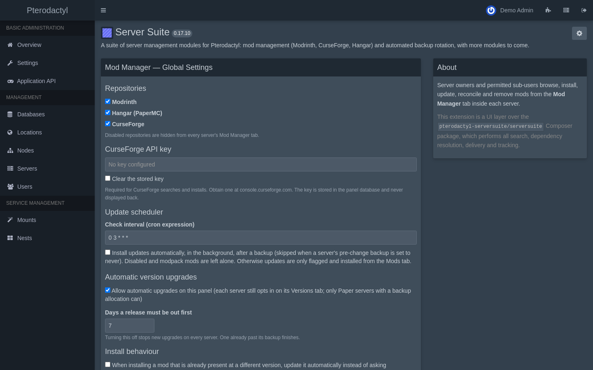

# Admin settings

**Admin → Extensions → Server Suite**.

{ .shot }

## Mods and updates

- Turn **Modrinth**, **CurseForge** and **Hangar** on or off. CurseForge needs an API key.
- **Update checks**: how often installed mods are checked, and whether updates are applied
  automatically (with a backup first).
- **Automatic upgrades**: how long a Minecraft release must have been out before servers that
  opted in upgrade to it (7 days by default).

## Backups

- Turn scheduled backups on or off panel-wide, with the default schedule and retention.
- **Backup timezone**, used in backup names and for the "time of day" setting.

## Subdomains

- **Domains** servers can claim names on: each is a Cloudflare zone with its own API token.
  Create the token in Cloudflare with **Zone → DNS → Edit** for that zone only (never the Global
  API Key). The token is checked with Cloudflare when added and stored encrypted. Disable a domain
  to stop new claims while existing names keep working.
- **Allowances**: how many subdomains each server may hold (default 0). To sell them, take
  payment outside the panel (or use the [Billing API](billing-api.md)) and raise the allowance.
- **Status cards**: `SERVERSUITE_STATUS_CARDS=false` in `.env` turns off every public status
  page. `SERVERSUITE_STATUS_CARD_CACHE` sets the ping cache in seconds (default 30). The pages are
  limited to 120 requests a minute per IP and can be cached by a CDN.

## Notifications

**Default notifications**: Discord webhooks and ntfy topics, and which events go out, for
servers that haven't set up their own.

## Games

Which game each egg runs. Rust and Valheim are found by the Steam app id in the egg's
`SRCDS_APPID`, Minecraft by the egg's tag, name, image or startup command. Pick the game for an
egg here if detection gets it wrong. See [Rust & Valheim](../features/games.md).

## Eggs

The **Egg Manager** imports eggs from the community catalogue (any game) or a URL, and keeps
installed eggs up to date.
