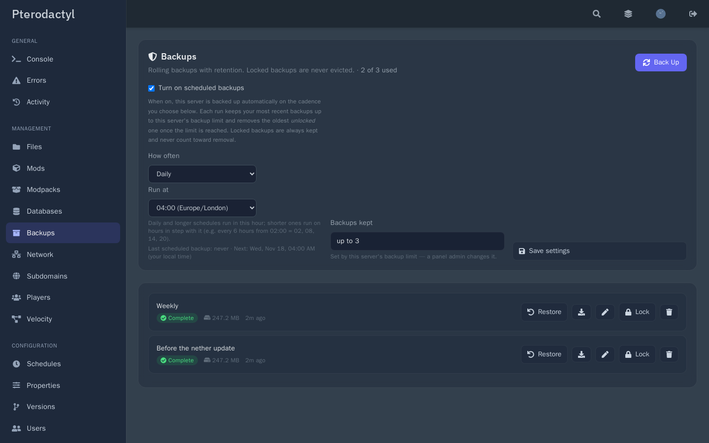

# Backups

Scheduled backups with automatic rotation, on top of the panel's own backups.

{ .shot }

- Pick how often (every 6 hours to weekly) and,
  optionally, a **time of day** to run.
- **Rotation** keeps the server inside its backup limit: the oldest *unlocked* backup is removed
  when a new one is needed. Locked backups are always kept, and the last good backup is never
  deleted.
- See the last and next scheduled backup.
- Back up now, **lock**, rename, download, restore or delete any backup. Restores across
  Minecraft versions warn you first.

## Restores put the mod list back

Every backup Server Suite takes saves the server's mod list with it. When a restore finishes
(from this page, the panel's own Backups page or the API), the mod list, the modpack and the
loader settings are put back to match, and the Mods page says what changed.

!!! tip "Self-hosted S3 on a private address"
    Recent Wings versions refuse restores from private addresses. See
    [Troubleshooting](../troubleshooting.md#backup-restore-blocked-address).
