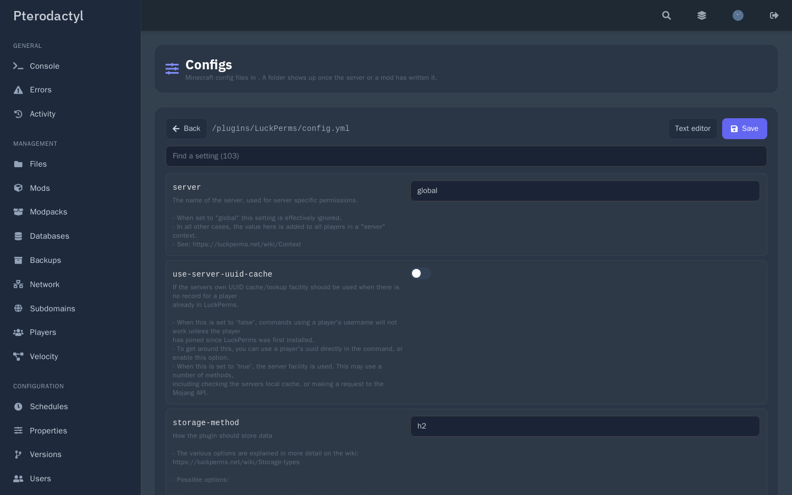

# Config editor

Edit plugin and mod configs in the panel, as a form.

{ .shot }

- A file browser scoped to the config folders (`plugins/`, `config/`, and on Pterodactyl also
  `defaultconfigs/` and `kubejs/`).
- **YAML, TOML, JSON/JSON5, `.properties`, `.ini`, Forge `.cfg` and `.conf`** files open as a
  form: switches for on/off settings, number boxes (with the allowed range when the file states
  one, as Forge and NeoForge configs do), dropdowns for known choices, text boxes, and
  one-per-line boxes for lists.
- **Only the values you change are written**, so comments and layout stay as they were. The
  result is read back and checked before anything is saved.
- **Text editor** switches to the raw file, and back.
- A save is refused if the server rewrote the file since you opened it, so you never overwrite
  its changes.
- Settings the form can't edit safely (YAML anchors, multi-line values, lists of objects) are
  left to the text editor.

Saving follows the [Backup before changes](mods.md#backup-before-changes) setting on Minecraft
servers. Rust and Valheim have their own [Configs page](games.md).
