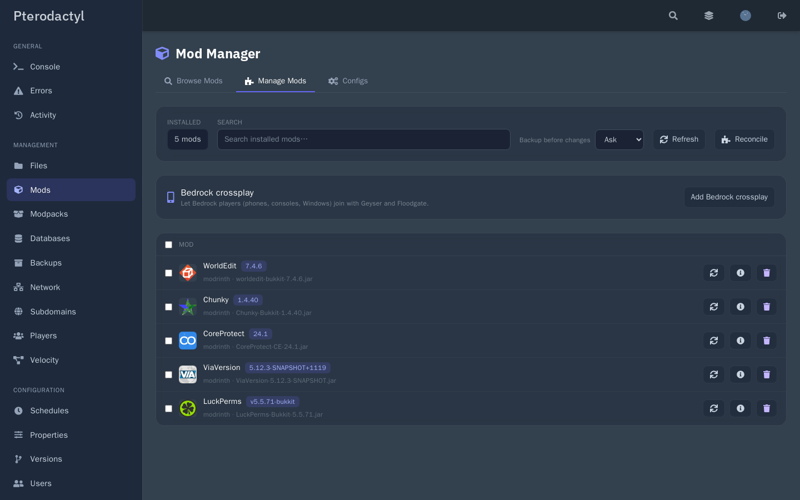

# Bedrock crossplay

Let phones, consoles and Windows players join a Java server.

{ .shot }

- One click installs **Geyser** and **Floodgate** (plus ViaVersion on Paper) on Paper, Purpur,
  Spigot, Fabric and NeoForge servers.
- **Set up connections** puts Geyser on the Java port using NetherNet (how Bedrock connects from
  27 October 2026) and GeyserMC's signalling. With a second allocation, older clients can keep
  using RakNet too.
- The card shows the address Bedrock players join with.
