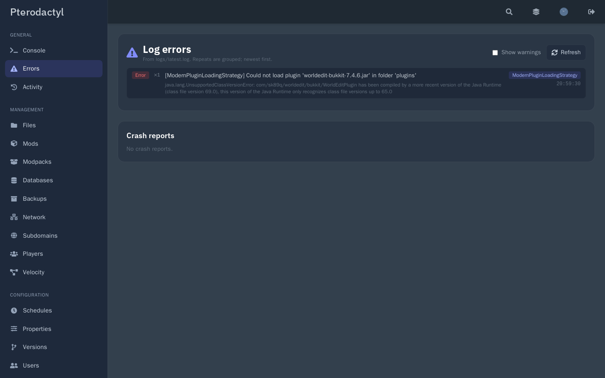

# Errors & crash help

## Errors page

The warnings and errors in `logs/latest.log`, grouped so repeats show once
("×42 Could not pass event ... to Essentials"), with when they first and last happened.

{ .shot }

- Click a group for the full stack trace.
- Each group names the plugin or mod it most likely comes from, and links it to your installed
  mods.
- Warnings are hidden until you tick **Show warnings**.
- Recent **crash reports**, with the suspects crash help finds.
- Only the end of a very large log is read, so the page stays fast.

## Crash help

If the server crashes after a mod change (a crash report, or a failed start in the log, written
after the change), the Mods page tells you:

- what changed,
- which mod is the likely cause (from the loader's messages or the stack trace),
- and offers to **disable** it, points at the backup taken before the change, or shows the
  report.

Nothing happens on its own: you decide.
