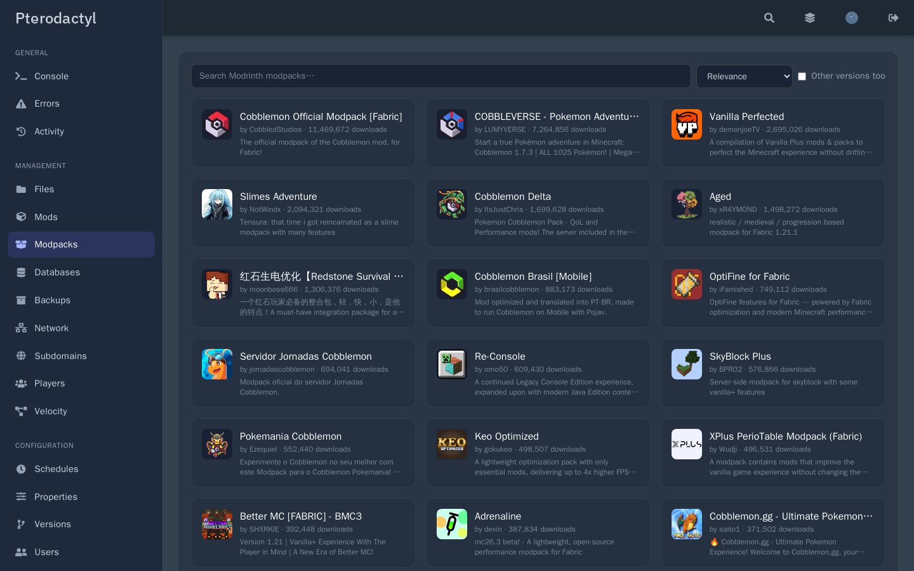

# Modpacks

Install a whole **Modrinth modpack** (`.mrpack`) in one go, and update it later as a pack.

{ .shot }

- Search shows packs with a build for the server's loader and Minecraft version.
- **Review first**: what gets downloaded, which files are skipped (client-only, or hosted
  somewhere the format doesn't allow), and what an update removes.
- The server is stopped and a *Pre-modpack* backup is taken before anything changes. Every file
  goes straight from its host to the server through Wings, and modpack files are checked against
  their SHA-1.
- **Mods you added yourself stay.** The pack's mods show a *modpack* badge.
- **Remove modpack** stops the server, takes a backup, deletes the pack's files (its configs only
  if you ask) and forgets it. Your own mods and worlds stay.

The server must already run the pack's loader and Minecraft version: change them on the
[Versions](versions.md) page first. Modpacks run on the panel's queue worker.

!!! note
    Modpacks are available on Fabric, Quilt, Forge and NeoForge servers.
