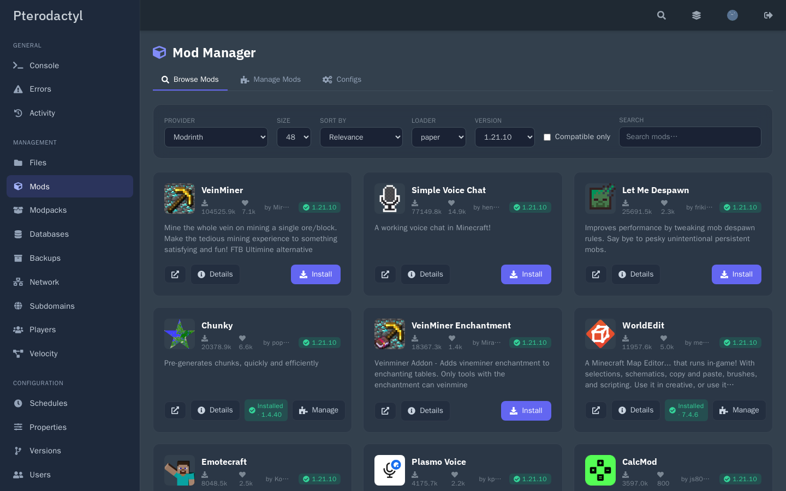
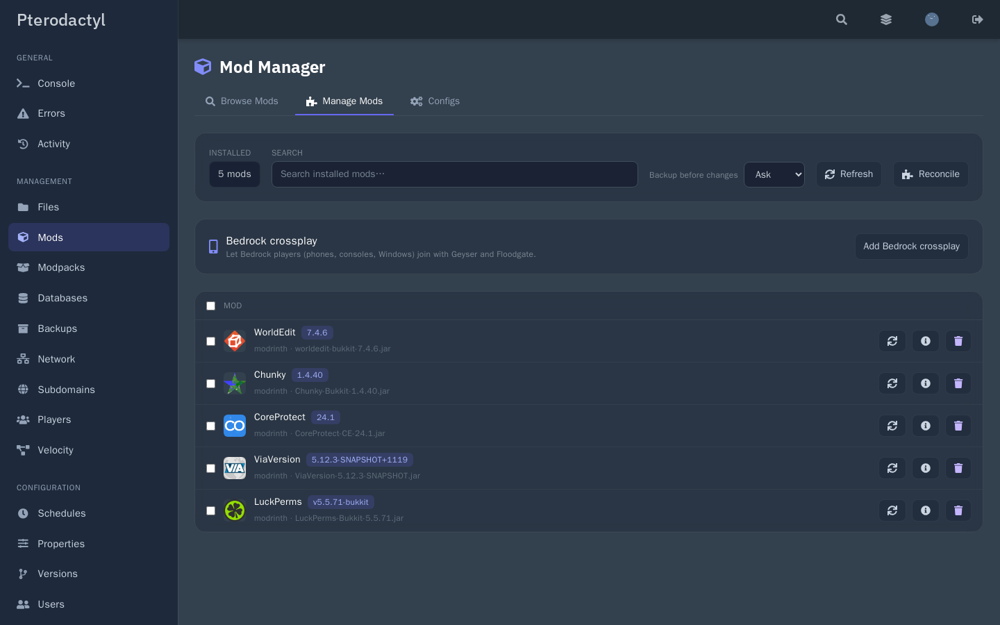

# Mods & plugins

Browse and install mods and plugins from **Modrinth**, **CurseForge** and **Hangar** without
leaving the panel.

{ .shot }

## Browse

- Search all enabled repositories at once. Filters for loader and Minecraft version are filled in
  from the server, and compatible versions are highlighted.
- **Install** a mod with one click. Required libraries are resolved and installed for you.
- Open a mod's **Details** to read its description, pick a specific version, or see its
  dependencies.
- Paper forks (Purpur and others) find Paper, Spigot and Bukkit plugins too.

Files are downloaded **by Wings straight to the server**. Nothing large passes through the panel.

## Install queue

Add several mods to the queue, each at the version you picked, then **Install N mods**:

- one plan (a library two mods need is installed once),
- one backup,
- one queued install with progress you can watch.

The queue is kept per user and server, so it survives leaving the page.

## Manage

{ .shot }

- Everything installed, with icons, versions and **update** badges.
- Update one mod or **update all**. Disabled mods and mods that came with a modpack are skipped.
- Tick several mods and **Remove N**. One dialog lists what's going, warns when a mod you keep
  needs one of them, and offers the libraries nothing will need afterwards.
- **Disable** a mod without removing it (it's renamed to `.disabled`, so the loader skips it).

## Backup before changes

Choose **Ask**, **Always** or **Never**. Before mods are installed, updated or removed (or a
config is saved), Server Suite takes a *Pre-mod-change* backup and only makes the change once it
has finished. A backup from the last 30 minutes is reused. The backup's name goes into the
server's Activity log so you know what to restore.

## Scheduled update checks

The panel checks installed mods for updates on a schedule the admin sets. Updates can be shown
as a badge, sent as a [notification](notifications.md), or applied automatically (with a backup
first).

## Files found on disk

Jars the suite didn't install are identified by hash on Modrinth. **Scan files** lists them, and
records whose file has gone. **Adopt** them to manage them here, or **Forget** the stale ones.

!!! info "CurseForge"
    CurseForge needs an API key, which the panel admin adds in the settings. Modrinth and Hangar
    work without one.
