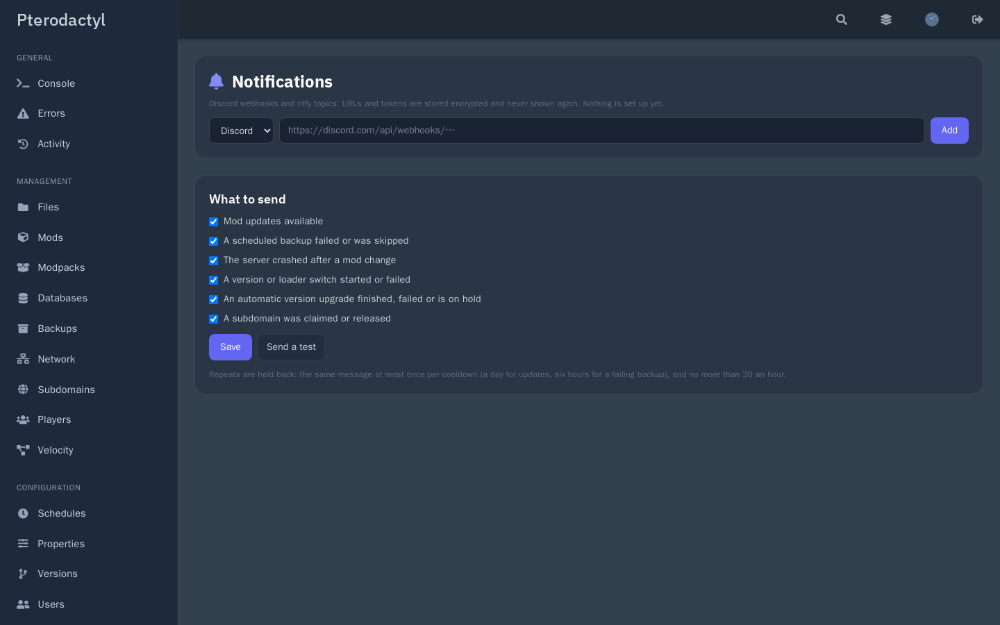

# Notifications

Send Server Suite events to **Discord webhooks** or **ntfy** topics.

{ .shot }

Events:

- mod updates available (or installed / failed, when updates are automatic),
- a scheduled backup that failed or was skipped,
- a crash after a mod change,
- a version or loader switch that finished or failed,
- subdomains claimed or released.

How it works:

- Each server can add its own targets and pick which events go out. Without its own, a server
  uses the admin's default targets.
- **Send a test** checks every target.
- Repeats are held back: a day for the same updates, six hours for a failing backup, and at most
  30 messages per server per hour.
- URLs and tokens are stored encrypted and never shown again.
- Targets a server owner enters must be on the public internet; the admin's default may point at
  your own network.
