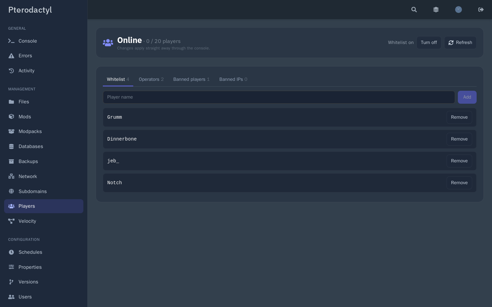

# Players

The whitelist, operators and bans as lists instead of raw JSON.

{ .shot }

- **Whitelist**, **operators**, **banned players** and **banned IPs**.
- Add players by name. The UUID comes from Mojang, or is the offline UUID when
  `online-mode=false`.
- While the server runs, changes go in as console commands (`whitelist add`, `op`, `ban`, ...)
  and apply at once. While it's stopped, the files are edited and the server reads them on start.
- Turn the whitelist on or off, and see who's online.
- Everything sent to the console is checked first (names, IPs, one-line ban reasons).

Hidden on Velocity and Waterfall proxies. [Rust and Valheim](games.md#players) have their own
player lists.
