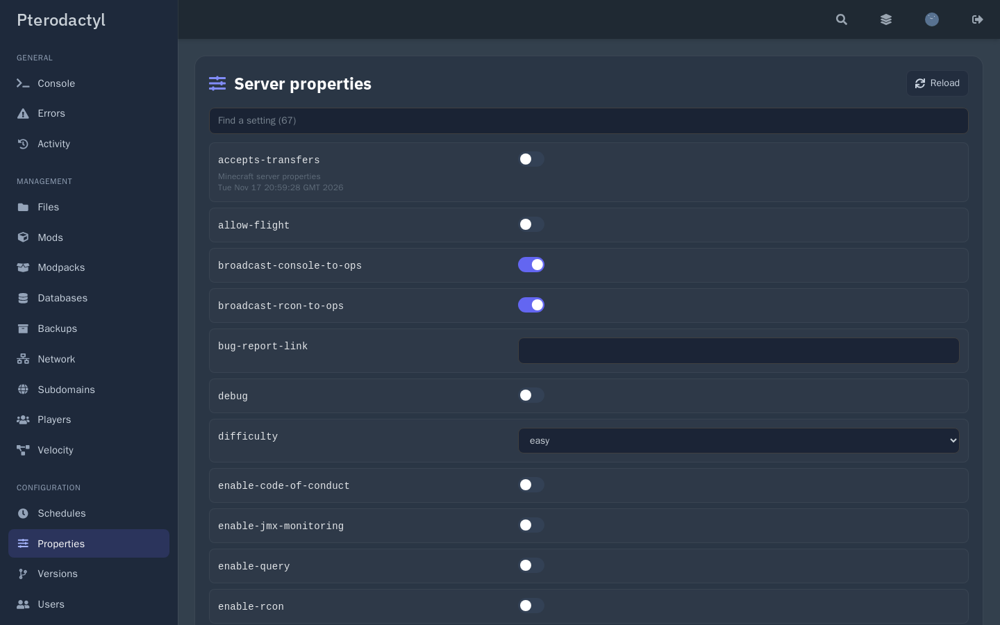

# Server properties

`server.properties` as a form.

{ .shot }

- Switches for on/off settings, number boxes, dropdowns (difficulty, gamemode, ...) and a filter
  box to find a setting fast.
- Only the values you change are written. Comments and the file's order stay, line endings are
  kept, and a typo can't add a new setting.
- **Save**, or **Save and restart**.
- Change `level-seed` and you can reset the world so the new seed applies: the server is stopped
  first, the world folders are deleted only once it's offline (plugins and configs stay), and it
  starts again.
- A save is refused if the file changed since you opened it.
