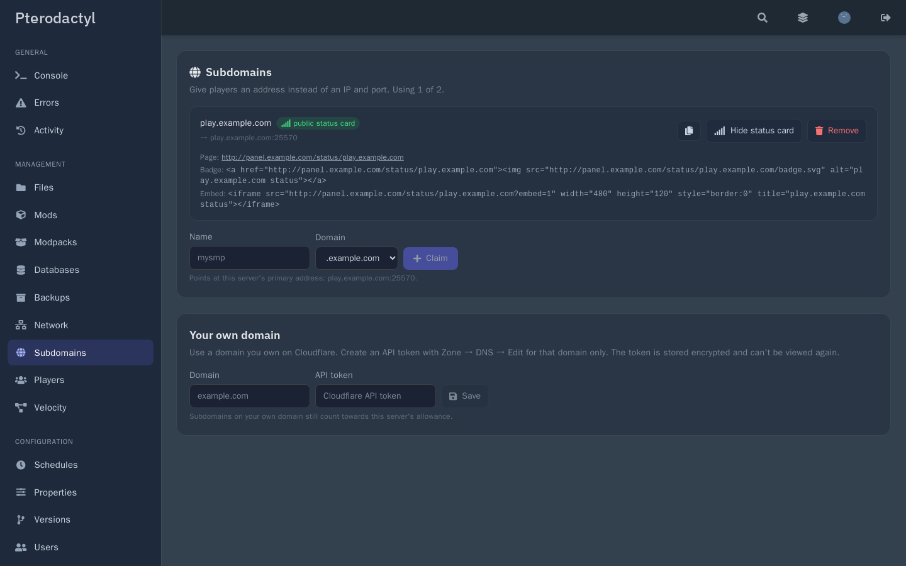
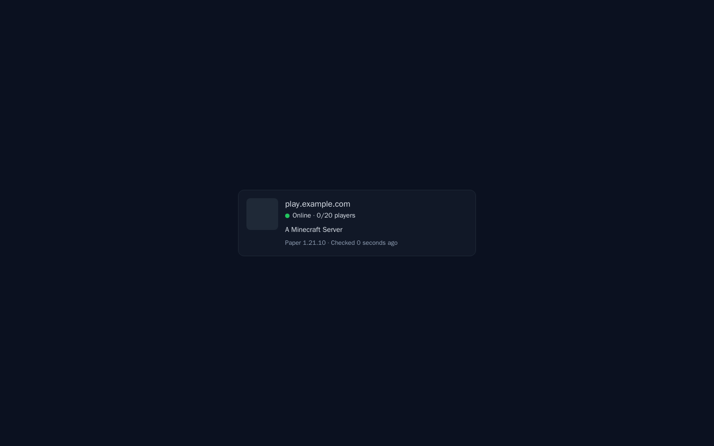

# Subdomains & status cards

Give a server a friendly address like `play.yourdomain.com`, managed through Cloudflare.

{ .shot }

- Claim a name on one of the **domains the panel offers**, or **bring your own** Cloudflare zone
  with a scoped API token (checked with Cloudflare and stored encrypted, per server).
- **Minecraft** needs no port: an SRV record carries it. **Rust, Valheim and other games** don't
  look up SRV records, so players join with the name and the port, which the page shows
  (`play.yourdomain.com:28015`).
- The address record is A (IPv4), AAAA (IPv6), or a CNAME when the allocation's alias is a host
  name. A name that already has any record in the zone can't be claimed.
- The admin sets how many subdomains each server may hold.
- **When the server's address changes**, its subdomains follow once the server has restarted on
  the new address, so players are never sent to a port the game isn't on yet. **Move now**
  forces it.
- **When a server is deleted**, its DNS records and its own-domain token go with it.

## Status cards

Optional and off by default. Switch it on per subdomain for a public page at
`/status/<subdomain>` on the panel's address.

{ .shot }

- Shows online or offline, players, MOTD, version and icon. Nothing else about the server (no
  IP, node or ID).
- Comes with a **badge** (`/status/<subdomain>/badge.svg`) and an iframe snippet to copy.
- The panel pings the server at most once every 30 seconds, however many people look.
- Minecraft servers only, for now.
