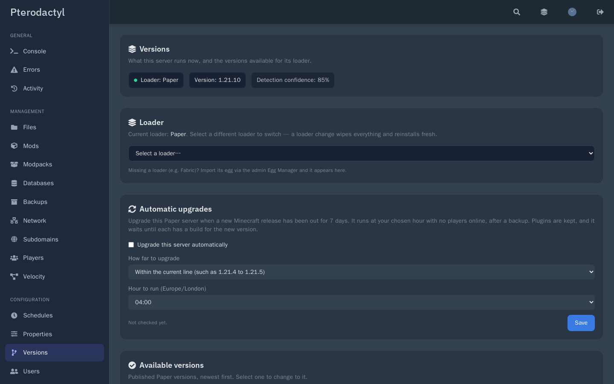

# Versions & loaders

Change the Minecraft version or the server software safely.

{ .shot }

## Switch version or loader

- **Change version** within the current loader, pinned to an exact build.
- **Switch loader** between Paper, Purpur, Folia, Fabric, Quilt, Forge, NeoForge, Velocity and
  more, choosing the target version in the same step.
- Every switch takes a **backup first**, wipes cleanly, installs the right files, sets the Java
  image the new version needs, and **starts the server for you**.
- The version you pick is installed, or you're told why not (for example, a build that doesn't
  exist for that loader).
- On a server with **no backup allocation**, switches still go ahead; the confirm dialog warns
  you that no backup will be taken.

Server jars come from [MCJars](https://mcjars.app) where the loader has a single jar (Paper,
Purpur, Folia, Fabric, Velocity, ...), which gets around broken egg install scripts.

## Automatic upgrades

Opt in per server, on a Paper server with a backup allocation. At the hour you pick, with no
players online, Server Suite takes a backup and upgrades to a release that has been out for a
while (7 days by default, set by the admin), within the current line unless you choose
"latest".

- Plugins are kept and moved to builds for the new version. If a plugin has no build yet, the
  upgrade waits.
- Servers in a Velocity network are skipped.
- If the server doesn't come back up, upgrades pause and you're told which backup to restore.

## Reinstall and reset

**Reset** the server: the world only, or a clean slate. Switches refuse up front when the
server can't be reinstalled (for example, *Skip Egg Install Script* is on), so a server is
never left wiped.
