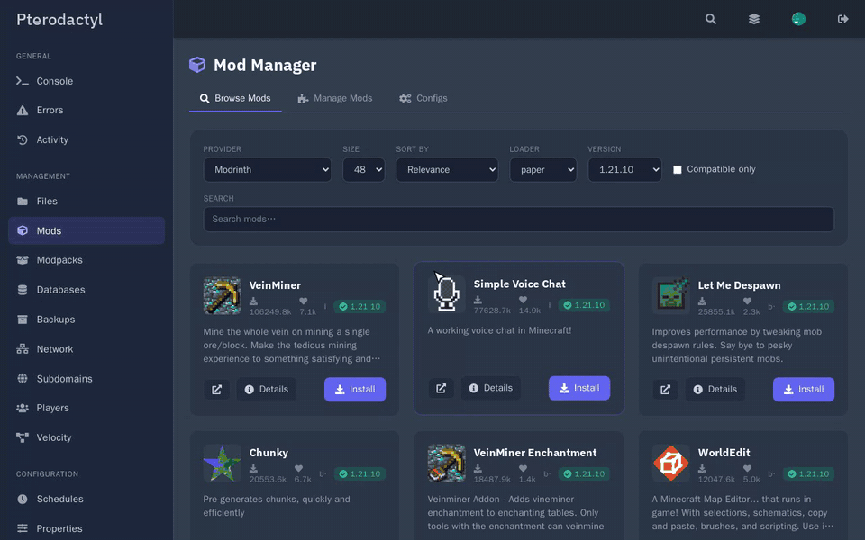

# Server Suite

Everything a Minecraft server owner reaches for, built into the game panel they already use.
Mods and modpacks, scheduled backups, one-click version and loader switches, a config editor,
players, subdomains and notifications, as new pages on every server.

**Free and open source** (AGPL-3.0) · for **Pterodactyl** 1.14 and 1.15

[Get started](install/index.md){ .md-button .md-button--primary }
[See the features](features/index.md){ .md-button }

{ .shot }

## What it adds

-   :material-puzzle:{ .lg .middle } **Mods & plugins**

    ---

    Search Modrinth, CurseForge and Hangar, filtered to the server's loader and version.
    Dependencies are resolved for you, updates are one click, and files go straight from the
    host to the server.

    [:octicons-arrow-right-24: Mods](features/mods.md)

-   :material-package-variant-closed:{ .lg .middle } **Modpacks**

    ---

    Install a whole Modrinth modpack in one go, review what it downloads first, and update it
    later as a pack. A backup is taken before anything changes.

    [:octicons-arrow-right-24: Modpacks](features/modpacks.md)

-   :material-backup-restore:{ .lg .middle } **Scheduled backups**

    ---

    Every 6 hours to weekly, at the time you choose, with rotation that stays inside the backup limit
    and never deletes your last good backup. Restores put the mod list back too.

    [:octicons-arrow-right-24: Backups](features/backups.md)

-   :material-swap-horizontal:{ .lg .middle } **Versions & loaders**

    ---

    Switch Minecraft version, or move between Paper, Purpur, Folia, Fabric, Forge, NeoForge and
    more, with a backup first and the server started for you. Optional automatic upgrades.

    [:octicons-arrow-right-24: Versions](features/versions.md)

-   :material-file-cog:{ .lg .middle } **Config editor**

    ---

    Plugin and mod configs open as a form: switches, numbers with their ranges, dropdowns and
    lists. Only what you change is written, so comments and layout stay.

    [:octicons-arrow-right-24: Configs](features/configs.md)

-   :material-account-group:{ .lg .middle } **Players**

    ---

    Whitelist, operators and bans as lists instead of JSON. Changes apply instantly while the
    server runs.

    [:octicons-arrow-right-24: Players](features/players.md)

-   :material-web:{ .lg .middle } **Subdomains & status cards**

    ---

    `play.yourdomain.com` through Cloudflare, on the panel's domains or the owner's own, plus an
    optional public status page and badge.

    [:octicons-arrow-right-24: Subdomains](features/subdomains.md)

-   :material-bell-ring:{ .lg .middle } **Notifications**

    ---

    Mod updates, failed backups, crashes after a mod change and finished switches, sent to
    Discord or ntfy.

    [:octicons-arrow-right-24: Notifications](features/notifications.md)

-   :material-alert-circle:{ .lg .middle } **Errors & crash help**

    ---

    The log's errors grouped and traced back to the mod that caused them. After a crash, it says
    what changed and offers to disable the likely culprit.

    [:octicons-arrow-right-24: Errors](features/errors.md)

## Also included

- **Bedrock crossplay**: Geyser and Floodgate in one click, so phones and consoles can join.
- **Velocity networks**: put servers behind a Velocity proxy with forwarding set up for you.
- **Server properties** as a form, with a safe world reset when you change the seed.
- **Rust and Valheim**: errors, configs, players, backups and subdomains for those games too.
- **Billing API** for Paymenter and other billing systems: sell subdomains and backup plans.
- **Permissions** for every page, so subusers see exactly what you allow.

## Which panel?

| | Pterodactyl 1.x |
|---|---|
| Ships as | A [Blueprint](https://blueprint.zip) extension + a Composer package |
| Panel versions | 1.14.x and 1.15.x |
| Install guide | [Pterodactyl](install/pterodactyl.md) |

!!! info "Coming later: Pelican and Pterodactyl v2"
    Server Suite for **Pelican** (a native Pelican plugin) and for **Pterodactyl v2** are in
    development. This first public release is for **Pterodactyl 1.x**.

!!! note "Release candidate"
    Server Suite is at 1.0.0 release candidate. It's tested against real panel installs on every change, but take
    backups and try it on a test server first.
